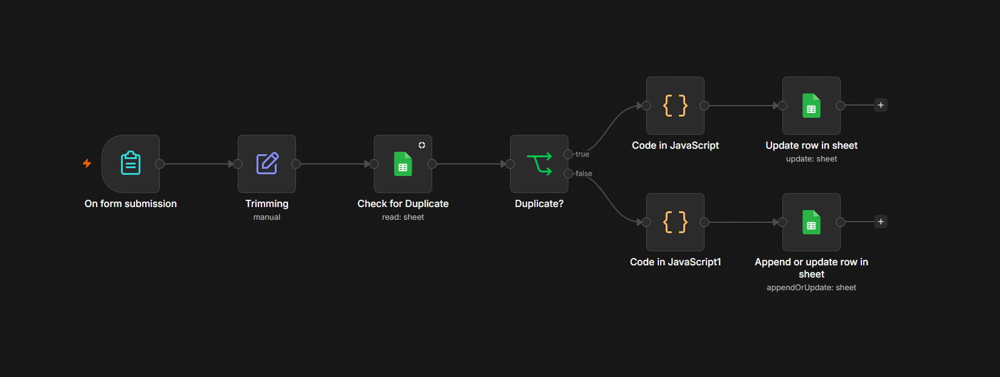
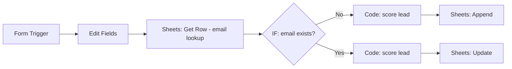
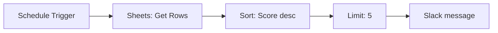

# Lead Scoring Automation (n8n)

A no-code lead pipeline built in n8n. A web form captures a lead, a rule-based scorer ranks it, Google Sheets stores it, and a scheduled digest posts the top 5 leads to Slack, so a sales person always knows who to contact first.



## What it does

1. Someone submits the lead form (Name, Email, Company, Message, Budget).
2. The workflow checks Google Sheets to see whether that email already exists.
3. The lead is scored by a Code node.
4. New leads are **appended**, returning leads are **updated** (with a fresh score).
5. On a schedule, a second workflow reads the sheet, sorts by score, and sends the top 5 to Slack.

## Workflows

| File | Purpose |
|---|---|
| `workflows/lead-intake-scoring.json` | Form → duplicate check → score → append or update in Sheets |
| `workflows/lead-digest.json` | Schedule → read leads → sort by score → top 5 → Slack |

### Intake and scoring



### Digest



## How scoring works

The Code node adds points from four signals:

| Signal | What it checks | Points |
|---|---|---|
| Email domain | Company domain vs. free provider (gmail, yahoo, etc.) | `[FILL IN]` |
| Budget bracket | Which budget option the lead picked | `[FILL IN]` |
| Message length | Longer, more detailed messages score higher | `[FILL IN]` |
| Keyword match | Buying-intent words in the message | `[FILL IN]` |

### Why rule-based and not AI?

- **Predictable:** the same lead always gets the same score, so results are easy to test.
- **Explainable:** you can point to exactly why a lead scored 70.
- **Free and fast:** no API calls, no rate limits, no cost per lead.
- **Easy to tune:** changing a threshold is a one-line edit, not a prompt experiment.

An LLM could later read the message and add a sentiment or intent signal on top of these rules. That would be an upgrade, not a replacement.

## Bugs I hit and how I fixed them

| Problem | Cause | Fix |
|---|---|---|
| Workflow stopped when the email was new | Google Sheets halts on a 0-item result | Turned on **Always Output Data** so the IF node still runs |
| Get Rows returned nothing with several filters | Multiple AND filters on one node | Simplified the filter and moved the check into the IF node |
| Fields came back `undefined` after the lookup | The search node overwrote `$json` | Reference earlier nodes explicitly: `$('Edit Fields').item.json` |
| Scores were wrong for some leads | Case-sensitive mismatch between form option text and Code node string checks | Normalized strings with `.toLowerCase()` and matched the exact option text |
| Returning leads kept stale scores | Only the append branch ran the scorer | Routed both branches through the same scoring Code node |
| Column dropdown stuck on "Loading options..." | Sheets node cache issue | Re-selected the document and sheet to refresh |

## Setup

**Requirements:** n8n (self-hosted or cloud), a Google account, a Slack workspace.

1. Create a Google Sheet with the columns: `Name`, `Email`, `Company`, `Message`, `Budget`, `Score`.
2. In n8n, import both files from `workflows/` (**Workflows → Import from file**).
3. Create credentials for **Google Sheets** and **Slack**, then attach them to the matching nodes.
4. Point every Google Sheets node at your own spreadsheet.
5. Set the Slack channel in the digest workflow.
6. Activate both workflows, submit a test lead through the form URL, and check the sheet.

The exported JSON contains no secrets. You must connect your own credentials after import.

## The clean-up script

n8n exports include instance-specific details. `scripts/clean-workflow.js` cleans an export before it gets committed:

```bash
node scripts/clean-workflow.js raw-export.json > workflows/lead-intake-scoring.json
```

## Project structure

```
lead-scoring-automation/
├── workflows/
│   ├── lead-intake-scoring.json
│   └── lead-digest.json
├── scripts/
│   └── clean-workflow.js
├── screenshots/
│   └── canvas-overview.png
└── README.md
```

## Limitations and next steps

- Score weights are hand-picked, not learned from real conversion data.
- The digest shows the top 5 only; there is no "contacted" status yet.
- Planned: a webhook with authentication as an alternative to the form, an AI-generated summary line per lead, and moving storage from Sheets to a database.

## Built with

n8n · Google Sheets · Slack · JavaScript (Code node)
